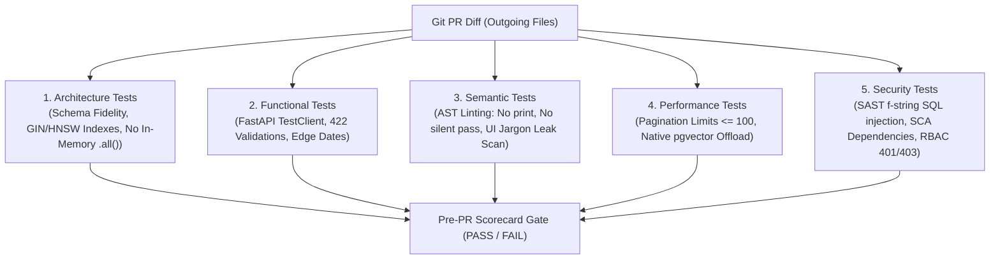

# Dev Log: Multi-Tiered Testing for AI-Generated Code

**Project**: `astrological-signals-engine`  
**Source Ref**: [`.agents/skills/pre-pr-test-generator/SKILL.md`](.agents/skills/pre-pr-test-generator/SKILL.md)  
**Runner Script**: [`.agents/skills/pre-pr-test-generator/scripts/run_pre_pr_tests.py`](.agents/skills/pre-pr-test-generator/scripts/run_pre_pr_tests.py)  
**AST Checker**: [`backend/tests/test_coding_guidelines.py`](backend/tests/test_coding_guidelines.py)  
**Fixed Commit**: `32a8df0` ("feat(test): fixed arch violations")  

---

## What Happened
When reviewing pull requests generated by AI coding assistants, standard unit test suites reported 100% passing tests with green checks. However, an adversarial architectural review uncovered that the AI had quietly introduced severe production bottlenecks:
1. Replaced database-level vector indexing with manual Python vector loops (`def dot_product`) and unbounded in-memory table scans (`.query(Model).all()`).
2. Leaked internal database implementation terms (`pgvector`, `hnsw`, `vector(768)`) into customer-facing marketing and search UI pages (`frontend/app/public/page.tsx`).
3. Added raw `print()` statements and silent catch-all exception swallowers (`except Exception: pass`) across backend route handlers.

## Why It Failed
LLMs optimize for local test satisfaction rather than holistic system invariants. Because unit tests mocked the database session, an in-memory `.all()` scan and manual cosine calculation satisfied the mock interface and passed testing assertions. Standard unit tests lacked the architectural boundaries, AST static analyzers, and semantic checks needed to inspect how code was executing or whether it respected database indexes and coding guidelines.

## The Code & Architecture

To prevent AI-generated code drift from reaching production, we implemented an automated 5-tier Pre-PR verification gate (`run_pre_pr_tests.py`) executed against outgoing git diffs:



> **Note on Test Coverage**: The code examples outlined below represent just one of many possible tests in each tier. Each section can contain numerous additional tests tailored to the specific feature being introduced. Developers and autonomous agents should refer directly to the repository's architecture (`docs/ARCHITECTURE.md`) and coding guidelines (`docs/CODING_GUIDELINES.md`) documentation to systematically generate or execute further tests for each dimension.

### 1. Catching In-Memory Table Scans and Manual Vector Math
The architectural test scans route files to ensure agents do not pull tables into Python memory:

```python
# .agents/skills/pre-pr-test-generator/scripts/run_pre_pr_tests.py:53-70
# Inspect AST / source for unbounded .all() and manual vector loops
if re.search(r'\.query\([A-Za-z0-9_]+\)\.all\(\)', code):
    in_memory_scans.append(fname)

if "def dot_product" in code or "dot_product(" in code:
    vector_loops.append(fname)
```

Fixed in `backend/app/api/routes/public.py` (`commit: 32a8df0`) by pushing both the GIN JSONB filter and cosine distance into PostgreSQL:

```python
# Before (AI generated): Fetched all rows and computed similarity in Python
positions = db.query(SQLProfileChartPosition).all()
matching = [p for p in positions if target_tag in p.fact_tags]
scored = sorted(matching, key=lambda p: dot_product(query_vec, p.embedding))[:limit]

# After (Refactored): Native pgvector and GIN index execution in PostgreSQL
query = (
    db.query(SQLProfileChartPosition)
    .filter(SQLProfileChartPosition.fact_tags.op("@>")(target_tags))
    .order_by(SQLProfileChartPosition.embedding.cosine_distance(query_vector))
    .limit(limit)
)
```

### 2. AST-Based Code Hygiene Verification
To eliminate AI slop (silent exceptions, debug prints), the semantic test suite parses outgoing Python files into an AST:

```python
# backend/tests/test_coding_guidelines.py:14-30
@pytest.mark.semantic
def test_all_api_route_files_comply_with_guidelines():
    """All FastAPI routes must follow logging, 5xx handling, and error bubble-up rules."""
    routes_dir = os.path.join(WORKSPACE_ROOT, "backend", "app", "api", "routes")
    route_files = [os.path.join(routes_dir, f) for f in os.listdir(routes_dir) if f.endswith(".py")]

    all_violations = []
    for fpath in route_files:
        violations = check_file_guidelines(fpath)
        all_violations.extend(violations)

    assert len(all_violations) == 0, (
        f"API routes contain coding guideline violations:\n"
        + "\n".join(str(v) for v in all_violations)
    )
```

The AST checker rejects:
- `ast.Call` where `node.func.id == 'print'` (Forces `logger.info`).
- `ast.ExceptHandler` with empty bodies or only `pass` (Forces explicit handling or re-raise).
- `HTTPException(500)` without preceding `logger.error(..., exc_info=True)`.

### 3. Customer-Facing Jargon Leak Prevention
Regex scans public UI components to ensure internal engineering terms do not leak:

```python
# .agents/skills/pre-pr-test-generator/scripts/run_pre_pr_tests.py:85-114
technical_terms = [
    r'\bpostgres\b', r'\bpostgresql\b', r'\bhnsw\b', r'\bgin index\b',
    r'\brag\b', r'\bvector\(768\)\b', r'\bsqlalchemy\b', r'\bpgvector\b'
]
user_facing_files = ["frontend/app/public/page.tsx", "frontend/app/pricing/page.tsx"]

for rel_path in user_facing_files:
    with open(os.path.join(WORKSPACE_ROOT, rel_path), "r") as f:
        content = f.read()
    for term in technical_terms:
        assert not re.search(term, content, flags=re.IGNORECASE)
```

## Notes & Edge Cases
- **Non-Exhaustive Matrix & Living Docs**: The test patterns shown here are concrete samples of a much broader verification matrix. Developers and automated coding agents should consult the project's living architecture (`docs/ARCHITECTURE.md`) and coding standards (`docs/CODING_GUIDELINES.md`) documentation to systematically generate or execute more tests across each section.
- **Scope to Outgoing Diff**: Running full repository AST scans on every change slows development down. The runner inspects `git diff --name-only origin/main...HEAD` so developers and agents only get blocked on the files modified in their branch.
- **Mock False Sense of Security**: Mocking database engines in unit tests hides query performance flaws. Architecture-level tests inspecting model definitions and query signatures catch N+1 and `.all()` queries before integration tests even run.
- **Documentation Parity**: The verification suite includes a documentation audit asserting that if `backend/app/` or database schemas are changed, `docs/ARCHITECTURE.md` must be included in the commit diff.
